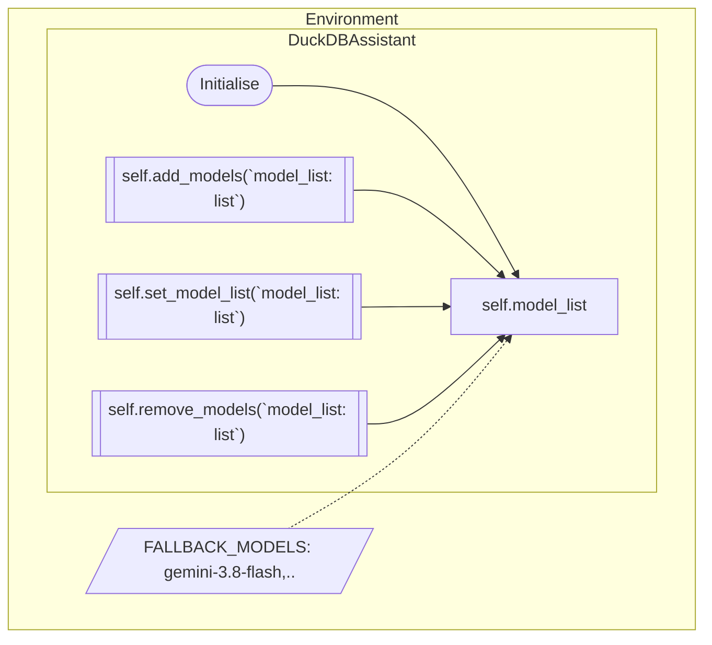
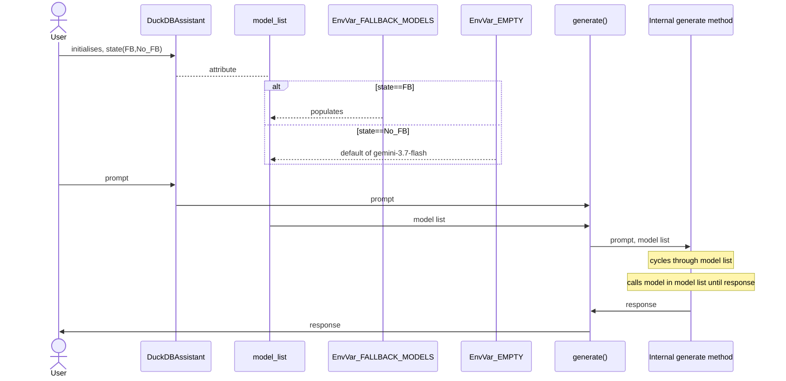
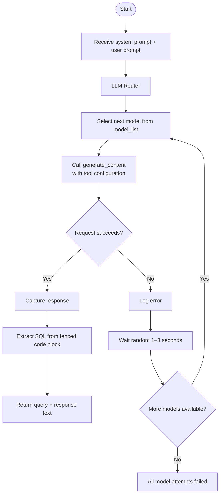

# LLM Router - Outline

The following outlines the approach towards using a Large Language Model (LLM) router that cycles through a list of models (all belonging to the Google Gemini family) to execute tasks requested in a prompt.

## Defining Candidate Models

The `model_list` attribute for every instance of an assistant class (`DuckDBAssistant`) contains candidate models which are available to that instance. This enables differentiation. `model_list` is initially populated bassed on an environmental variable, `FALLBACK_MODELS` and can be subsequently added to, replaced with a new list or pruned further.

## Prompt Execution

The user experience from the time of initialising an instance of a `DuckDBAssistant` and then using the instance to generate SQL is depicted below.

## Internal Generate Method - Execution

The process followed in the internal generate method (`generate_duckdb_query()`) is depicted below.  The `model_list` is a container of all available candidate models which are accessed based on their position in the list. If a candidate model fails (either due to availability issues emnating from a spike in demand or other reasons), then a time-out is enforced (a random period lasting between 1 - 2 seconds) before the next model in the list is taken up.

